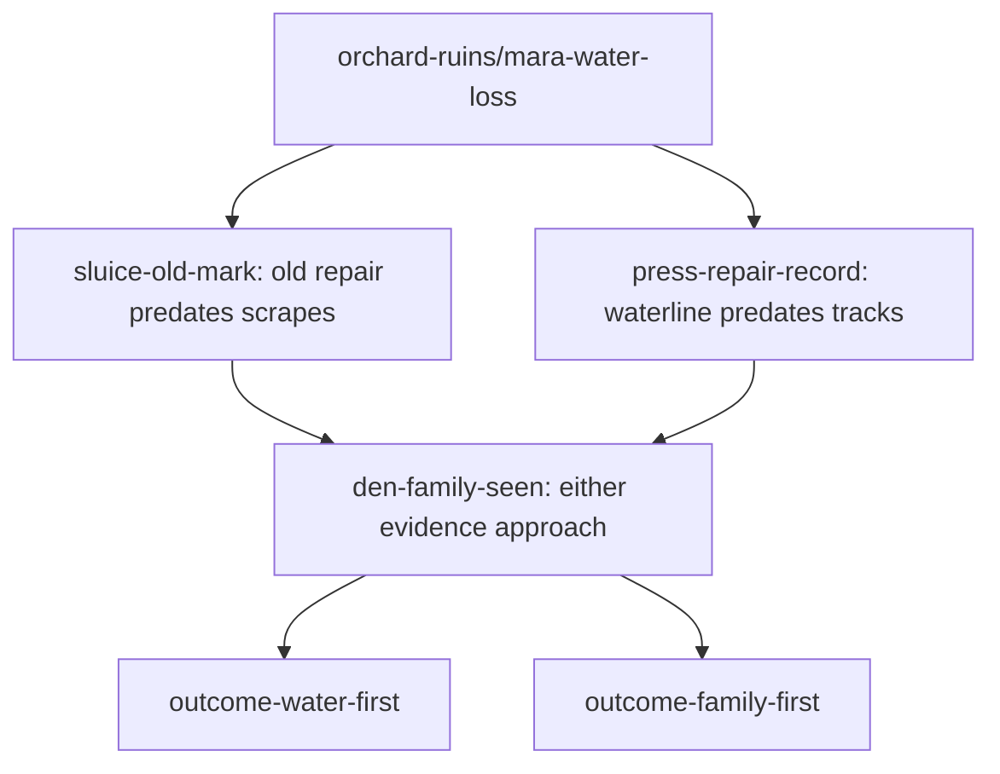

# Orchard investigation: discoveries and routes

Issue #260 completes the previously integrated #299 graph. The wider [slice brief](design/ORCHARD_MYSTERY.md) still assigns bespoke family staging, non-defeat encounter and later-map consequences to their own issues; this delivery does not claim those features exist.

## Play locally

On `integration`, run `npm ci`, then `npm start`. Continue an adventure with the Meadow seal and enter The Ruined Orchard from Meadow. Talk near Mara (7,15), then investigate either the press on the southern loop (30,44) or the broken channel beside the eastern wall (56,27). Both routes lead to the low hollow (42,36). Inspect the higher roots (44,34) or channel stones (49,41) to choose a priority. Open **Field journal** to read only evidence already encountered. Save/reload after the first clue, revisit the hollow, and confirm only one outcome pays ten coins. Existing map, creature and save identities remain unchanged.

## Stable evidence graph

Each clue requires the brief. The den requires the brief and either clue, never both. The two terminal events exclude one another. These canonical scene events survive normal per-adventure save, backup/import and reload; repeated inspection cannot pay twice. `validateSceneGraph` rejects nonexistent scene/route keys and positive dependency cycles, including an alternative branch that remains impossible. It deliberately does not certify external seal attainability, geography, story truth or mutually exclusive flags; owning validators and route tests cover those boundaries.

## Physical geography and art audit

The existing cider press, broken orchard wall, hollow oak and mossy stones support the story at actual renderer scale. Seven static water tiles show the pocket below the broken feeder and seepage beside the low roots through the existing terrain renderer. They preserve the public path and do not animate either outcome. The later [#265 follow-up](ORCHARD_CONSEQUENCES.md) derives adult and repair-board placements plus Mara/Rowan responses from committed outcomes; it does not add juvenile or water-flow animation. Mara reports a suspicion about a wild Bramblebuck; inspecting either clue establishes the earlier failure. A 32px unchanged `wood-plank-stack` sits at (55.4,28.1), beside the broken channel: the weathered attempted repair establishes that the failure predates fresh animal damage. It is scenery, not loot, harvest, inventory, reward or collision. Ravenmore's [source terms](../art/assets/third-party/ravenmore-resource-icons-01/README.md) and registered visual catalogue were checked before placement. The full icon download is not retained; portable exports still omit these images. Firewood and straw have no specific orchard beat and are intentionally not placed here. No new art was commissioned or generic art relabeled as juvenile creature artwork.

The destination is the existing eastern wall/channel along the main path; the southern press branch loops back toward the lower row. The old genuine west/east sign remains, while secret-announcing shortcut copy is removed. Physical hollow/channel inspection labels do not appear on the map until the object is discovered. The narrow western route and quiet eastern/press approaches avoid mandatory random battles; outer tallgrass retains its authored habitats. The investigation does not require any companion ability or capture, so every configured starter has the same routes. No Reedfen hidden-route contract was changed.

## Review and limitations

`tests/orchard-clues.browser.mjs` uses collision-aware path planning only to choose ordinary targets, then drives real keyboard or touch-pad events. It records each independent approach, reloads midway, continues to a distinct outcome and verifies durable once-only rewards. Debug access reads state; it does not teleport, grant evidence or trigger interactions. `ORCHARD_REVIEW=1 CHROMIUM=/usr/bin/chromium node tests/orchard-clues.browser.mjs` retains desktop/phone screenshots and measured control-run distance/time under `docs/scene-quality/260/`. Observed distance samples live player positions; planned distance and repeated half-tile edges describe the chosen walk route (including the deliberate resolved-point revisit). Recorded wall time includes automated input sampling, dialogue and reload and is not a human first-play enjoyment measure. The 8–12 minute full-slice target includes later encounter/staging work and is not claimed by this smaller graph delivery.

The inherited narrative interaction describes the family in text; hollow art does not depict juveniles or water-state animation. Those separate slice requirements stay open. Owner comprehension/enjoyment remains a manual playtest rather than an automated claim.

Older saves retain their map/event identities. A saved standing point on a newly wet tile uses the existing nearest-walkable arrival recovery; no alternate codec or manual conversion is introduced.
